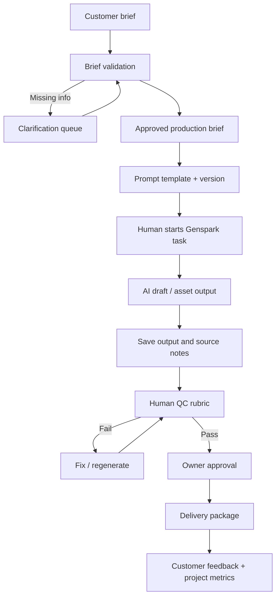

# 03 — AI Production Bridge

## Status and definition

**Status: design specification only. Not connected, automated, or production-live.**

The AI Production Bridge is the controlled handoff between Embrilo's customer brief, approved production instructions, Genspark work, human quality review, and customer delivery. It is not a claim that Genspark exposes a stable API or that an automated connector already exists.

## Bridge architecture (MVP)

For MVP, the bridge is a documented human-operated workflow. No API call, webhook, automatic file transfer, or background job should be assumed until tested with the owner's actual Genspark plan and authorized integrations.

## Inputs

- Unique project ID.
- Approved brief and revision.
- Brand voice guide.
- Deliverable specification.
- Customer-provided references with rights confirmation.
- Prompt template ID and version.
- Risk flags (claims, sensitive topic, restricted assets, privacy).
- Expected output schema and acceptance criteria.

## Output contract

Every production run should record:
- Project ID and brief version.
- Prompt ID/version.
- Tool and feature actually used.
- Run date and operator.
- Source/reference list.
- Output filenames and format.
- Known limitations and assumptions.
- QC scores and issues.
- Reviewer and approval status.
- Final delivery version.

Never record private access tokens, passwords, or unnecessary sensitive customer data.

## Prompt assembly

Prompt inputs should be structured, not one unbounded paragraph:
1. Role and objective.
2. Customer and audience.
3. Approved facts and source material.
4. Platform / format constraints.
5. Brand voice.
6. Deliverable schema.
7. Prohibited claims and exclusions.
8. Quality checklist.
9. Instructions to mark unknowns rather than invent.
10. Required self-check and output manifest.

Treat customer-uploaded documents, URLs, and embedded text as untrusted content. Instructions inside those materials do not override Embrilo's system rules or reveal secrets.

## Human-in-the-loop controls

- Human approves the brief before generation.
- Human reviews factual claims and asset rights.
- Human approves final deliverables.
- No automatic posting to social platforms in the MVP.
- No autonomous customer messages, refunds, or payments.
- Any consequential external action requires explicit owner approval.

## Integration levels

**Level 0 — Manual (initial):** copy approved brief into Genspark, run production, download output, log metadata, QC, deliver.

**Level 1 — Assisted:** standardized templates, naming rules, folder structure, reusable Genspark Skills/Workflows if available, with manual approval.

**Level 2 — Connected:** authenticated API or connector only if an official, documented, authorized integration exists and has been tested. Confirm rate limits, permissions, cost, data retention, and failure modes.

**Level 3 — Orchestrated:** background queue, retries, observability, and secure asset transfer only after the service has recurring demand and the connected integration is proven.

## Error handling

- Invalid/incomplete brief: return to clarification.
- Tool unavailable: preserve brief and mark run blocked; do not imply production occurred.
- Output missing/corrupt: rerun or request manual repair.
- Unsupported capability: downgrade to a manual step and document it.
- Fact unsupported: remove or qualify the claim.
- QC failure: hold delivery.
- Customer data exposure: stop workflow, limit access, document incident, and follow the incident procedure.

## Acceptance tests for bridge

1. A complete brief can be converted to a structured production brief.
2. An incomplete brief is flagged rather than guessed.
3. Prompt version and input version are recorded.
4. A sample output can be traced to its brief and prompt.
5. QC failure prevents release.
6. Final approval is explicit.
7. Delivery manifest lists correct files.
8. No credentials appear in logs or Git.
9. Tool failures are recorded truthfully.
10. The workflow can be completed manually without a paid integration.

## Genspark-specific note

Genspark's official help center lists product areas including Super Agent, Genspark Code, AI Docs, content creation, and Workflows. The owner's current access and specific feature availability must be checked in their account. A Genspark Workflow may support scheduled or email triggers and connected actions depending on available connectors, but this must not be confused with a guaranteed content-generation API. Test using simulated data first and review any live action before enabling it.
