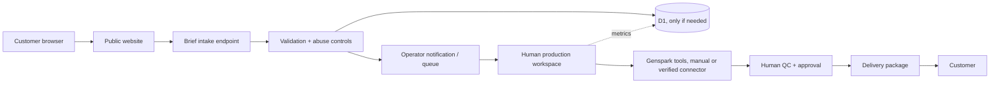

# 05 — Technical Architecture

## Architecture principle

Start with the smallest architecture that supports a public information site and reliable service delivery. The production workflow can remain manual while the business validates demand. Do not add an API integration simply because it is technically possible.

## Recommended stages

### Stage A — Service validation
- Public landing page and contact/intake form.
- Manual quote and project tracking.
- Genspark used by an operator, with output downloaded and reviewed.
- Files stored in a controlled folder with customer-specific access.
- No database, payment API, or autonomous external action required.

### Stage B — Lightweight web MVP
- Frontend: TypeScript with a lightweight framework (Vite is a reasonable candidate).
- Runtime/backend: Cloudflare Workers with Hono if server-side endpoints are needed.
- Database: Cloudflare D1 only when structured tracking is useful.
- Object storage: Cloudflare R2 only when secure file storage needs justify it.
- GitHub repository as source control.
- Domain: embrilo.biz.id, DNS and deployment to be configured and verified by owner.

Cloudflare's current documentation recommends Workers for new full-stack projects and describes Pages as a static/full-stack option. Choose one deployment pattern rather than mixing both without need. See [Cloudflare Pages](https://developers.cloudflare.com/pages/) and [Workers](https://developers.cloudflare.com/workers/).

## Logical architecture

The dotted metrics path is optional. In Stage A, the operator may use a controlled tracker rather than D1.

## Stack decision matrix

| Need | Preferred candidate | Why / gate |
|---|---|---|
| Public site | Vite + TypeScript or simple static HTML | Fast, low cost, easy to deploy |
| Server endpoints | Hono on Cloudflare Workers | Add only for validation, rate limits, and server-side actions |
| Relational data | D1 | Use when records exceed safe manual tracking |
| Private assets | R2 or controlled private storage | Do not expose customer assets through public URLs |
| AI generation | Genspark features available in the owner's account | Manual bridge first; verify connectors and plan |
| Payments | Manual verified payment initially; provider adapter later | Do not accept an untested payment callback as proof |
| Analytics | Minimal privacy-conscious event metrics | Do not add a heavy tracker without a question it answers |

## API boundaries if backend is implemented

- `POST /api/briefs`: validate and store a brief.
- `GET /api/health`: basic service health, no secret data.
- Admin endpoints: only after authentication and authorization are designed.
- Do not expose customer project records in public GET endpoints.
- Payment webhook endpoint: out of scope until provider is chosen, signature validation is implemented, and test cases pass.

## Security and privacy

- Keep secrets in Cloudflare secret bindings or equivalent, never in repository files.
- Use server-side validation and request size limits.
- Rate-limit public submissions and apply spam controls.
- Avoid uploading confidential customer information into AI tools without checking customer permission, tool data handling, and the agreed scope.
- Enforce private-by-default file access.
- Use least privilege for GitHub and Cloudflare integrations.
- Separate public site content from internal customer operations.
- Document deletion/retention and incident response.

## Deployment gate

Before claiming production:
1. Confirm repository branch and build command.
2. Configure project and domain DNS.
3. Deploy to preview.
4. Test mobile and desktop.
5. Test form validation, abuse handling, and failure states.
6. Verify HTTPS and domain routing.
7. Confirm no secrets or private assets are exposed.
8. Record actual deployment URL and test evidence.

## Self-service architecture addendum (2026-10-29)

Required flow: landing/onboarding → Google OAuth/session → user provisioning and one-time grant → authenticated workspace → validated generation API → atomic entitlement reservation and job → verified provider adapter → private asset storage → owner-authorized result. Add endpoints for current user/entitlement, onboarding, generation submit/list/status, and secure asset retrieval only as needed by the existing stack. Provider access and cost must be verified; disable any mode with unknown access or unbounded cost. See docs/11-customer-onboarding-and-free-tier.md.
